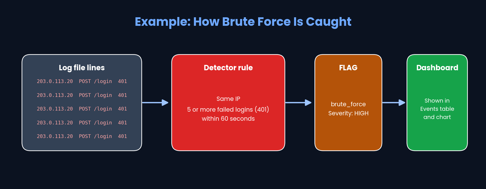

# How LogLens Works

LogLens reads server log files and finds suspicious activity,
such as someone trying to guess a password again and again.

## The Big Picture

## What Each File Does

| File | Job in simple words |
|---|---|
| `app.py` | Runs the website. Takes your upload, calls the other files, sends results to the page. |
| `parser.py` | Reads one log line and splits it into IP, time, request and status. |
| `detector.py` | Checks the clean records for attacks. |
| `signatures.json` | The list of attack patterns the detector knows. |
| `templates/index.html` | The page you see in the browser. |
| `samle_logs/` | Practice log files for testing (like `brute_force.log` and `demo.log`). |
| `requirements.txt` | Tools the project needs (Flask, gunicorn). |
| `.gitignore` | Tells Git which junk files not to upload. |

## Example: How Brute Force Is Caught

## Safety Rules in the App

- Only `.log` and `.txt` files are allowed.
- Maximum file size is 10 MB.

## Where Is It Running?

- On my laptop: run `python app.py`, then open http://127.0.0.1:5000
- Live on the internet (Render): https://loglens-5bhx.onrender.com
- Code on GitHub: https://github.com/sarkarayan1112-lab/LogLens

> Note: results are indicators for investigation, not proof of an attack.
