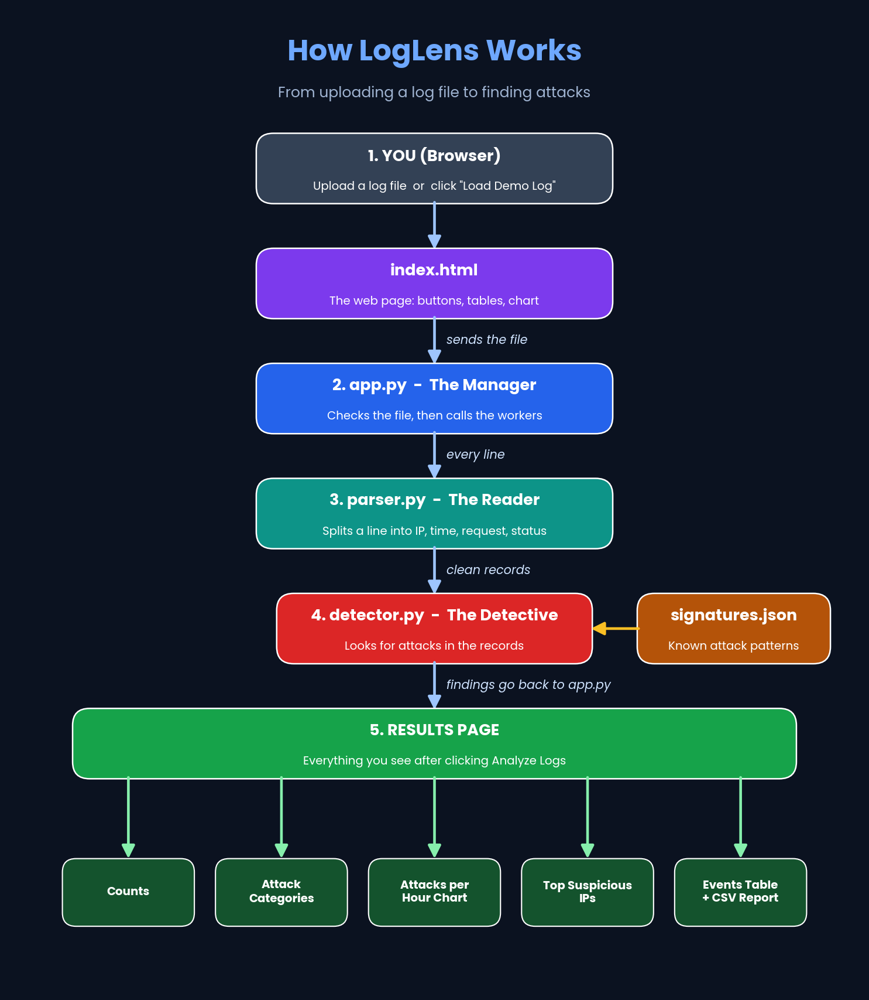

# LogLens - Simplified Security Log Analysis

LogLens is a web tool that reads Apache/Nginx server logs and finds suspicious activity,
such as SQL injection, cross-site scripting (XSS), directory traversal and brute-force
login attempts. The results appear in a clean dashboard.

**Live demo:** https://loglens-5bhx.onrender.com
(Click **Load Demo Log** to see the dashboard fill with detected attacks.
The app is on a free plan, so the first load can take up to a minute.)

## Features

- Upload a `.log` or `.txt` file in Apache/Nginx log format (Common or Combined)
- **Load Demo Log** button that analyzes a pre-loaded file containing attacks
- Detects SQL injection, XSS, directory traversal and brute force
- Severity and attack type tag for every finding
- Overview counts: total lines, parsed records, invalid lines, suspicious findings
- Attacks-per-hour line chart
- Top suspicious IP addresses table
- **Attacker map**: shows where attacking IP addresses are located (GeoIP lookup)
- Detected events table
- Export all findings as a CSV report
- Animated, responsive dashboard

## How It Works



1. The browser uploads the log file to `app.py`.
2. `parser.py` turns each log line into clean fields (IP, time, method, path, status).
3. `detector.py` compares each record with the attack patterns in `signatures.json`.
   Brute force is detected in `app.py` by counting failed (401) logins from one IP.
4. `geo.py` looks up the location of the attacking IP addresses for the map.
5. The results are sent back to the dashboard.

More diagrams and a plain-words explanation are in the
[How_it_works](How_it_works/How_it_works.md) folder.

## Project Structure

```
LogLens/
├── app.py               Flask app: upload, analysis, dashboard
├── parser.py            Regex parser for Apache/Nginx log lines
├── detector.py          Attack detection using the signatures
├── geo.py               GeoIP lookup for the attacker map
├── signatures.json      Attack patterns (regex) with type and severity
├── requirements.txt     Python packages
├── templates/
│   └── index.html       Dashboard page
├── samle_logs/          Sample logs, including demo.log
├── How_it_works/        Diagrams and explanation
├── PERFORMANCE_NOTE.md  How large files are handled
└── README.md
```

## Tech Stack

- **Backend:** Python, Flask, regular expressions
- **Frontend:** HTML, CSS, JavaScript, Chart.js, Leaflet (map)
- **GeoIP:** ip-api.com free batch service (no key needed)
- **Hosting:** Render (gunicorn)

## Run It on Your Computer

1. Download or clone the repository:
   ```
   git clone https://github.com/sarkarayan1112-lab/LogLens.git
   cd LogLens
   ```
2. Create and activate a virtual environment:
   ```
   python3 -m venv .venv
   source .venv/bin/activate
   ```
   On Windows, use `.venv\Scripts\activate` for the second line.
3. Install the packages:
   ```
   pip install -r requirements.txt
   ```
4. Start the app:
   ```
   python app.py
   ```
5. Open http://127.0.0.1:5000 in your browser.

## Performance

Files are streamed to disk in 64 KB chunks and then read one line at a time, so the
whole file is never loaded into memory. The upload limit is 10 MB because of the small
free hosting plan. Details and future improvements are in
[PERFORMANCE_NOTE.md](PERFORMANCE_NOTE.md).

## Limitations

- Maximum upload size is 10 MB.
- Supports Apache/Nginx Common and Combined log formats only.
- The map needs public IP addresses. Private or reserved addresses (for example test addresses such as 203.0.113.x) cannot be located.
- GeoIP uses a free service meant for non-commercial use, limited to a few lookups per minute.
- No background job queue yet (listed as future work in the performance note).

## Disclaimer

Signature matches are indicators for investigation, not proof of an attack.
A real person should review every finding.

## About

Cybersecurity internship project.

Demo data uses sample IPs for illustration only.